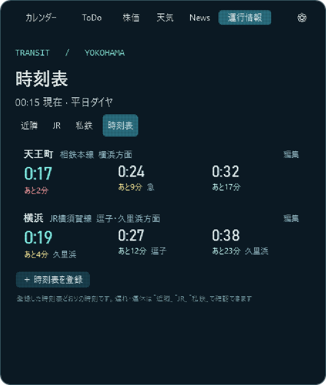
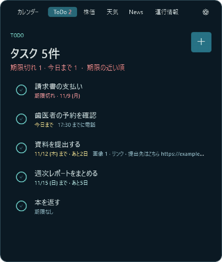
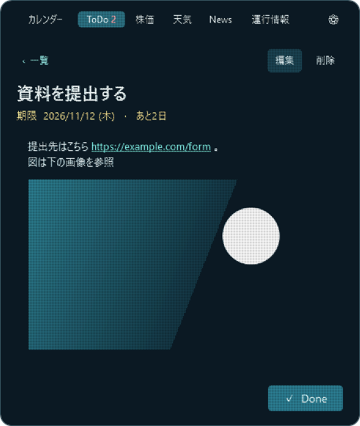
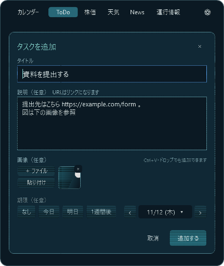
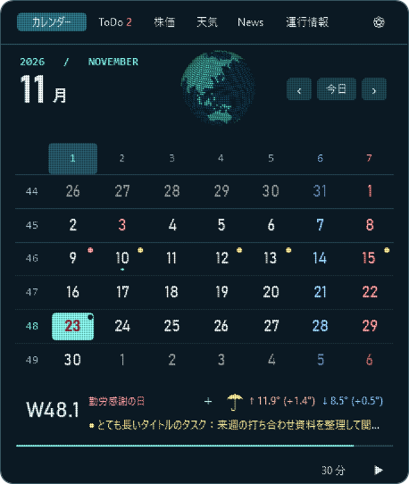
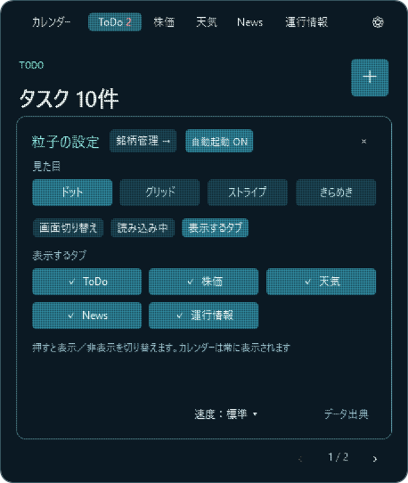

# Orbit Calendar

Windowsのタスクバーの日時をクリックすると開く、粒子でできたカレンダーです。
カレンダーのほかに、株価・天気・ニュース・運行情報・ToDo・タイマーをまとめて見られます。

[Windows版をダウンロード](https://github.com/NaitoMitsuharu/OrbitCalendar/releases/latest/download/OrbitCalendar.exe) · [リリース一覧](https://github.com/NaitoMitsuharu/OrbitCalendar/releases)

## カレンダー

週番号・曜日番号・祝日と、今日の天気・気温をひと目で確認できます。スクロールで月を切り替えられます。

## 株価

日経平均やドル円、個別株、投資信託（オルカンなど）のチャートを表示します。名前や愛称で検索して銘柄を追加できます。

| チャート | 銘柄の検索 |
| --- | --- |
|  |  |

## 天気

1時間先までの雨雲の動きと、3日間の天気予報を表示します。自宅や職場など、よく見る地点を登録して切り替えられます。

| 雨雲 | 3日間の天気 |
| --- | --- |
|  |  |

## ニュースと運行情報

ニュースは「総合」「経済」「IT」から1記事ずつ表示します。運行情報は横浜周辺の路線の遅れや運転見合わせを表示します。

| ニュース | 運行情報 |
| --- | --- |
|  |  |

運行情報の「時刻表」では、よく使う駅を登録しておくと、今の時刻から次の電車を「あと何分」で表示します。時刻表は[公共交通オープンデータセンター（ODPT）](https://developer.odpt.org/)から駅名を検索して取り込むか、自分で入力します。ODPTを使うには開発者登録で発行されるアクセストークンが必要です（相鉄・東急・JR東日本・京急はチャレンジ限定データのため、2027年3月12日までの利用です）。遅れは反映されません。

## ToDo

やることを一覧で管理できます。右上の ＋ からタイトル・説明・画像・期限を入れて追加します（タイトル以外は空欄でもOK）。説明のURLはリンクになります。左の ○ か、詳細画面の Done で完了にすると一覧から消えます。

| 一覧 | 詳細 |
| --- | --- |
|  |  |

期限を決めたタスクはカレンダーの日付に印が付き、その日を選ぶと W48.1 の下にタイトルが出ます。カレンダーの日付をダブルクリックすると、その日が期限のタスクを追加できます。画像はファイルのほか、ブラウザーやスクリーンショットでコピーした画像も付けられます。完了したタスクは一覧下の「完了済み」から見返して戻せます。

| 追加 | カレンダー |
| --- | --- |
|  |  |

## タイマー

時間を選んでスタートできます。ウィンドウを閉じても小さな窓に残り時間が表示され、終わると音と通知で知らせます。

## 見た目のカスタマイズ

歯車ボタンから、粒子の見た目・組み上がり方・読み込み中のアニメーション・速さを選べます。「表示するタブ」で、使わないタブを隠すこともできます。

| 流れ込み | 奥行き |
| --- | --- |
|  |  |

## 使い方

1. `OrbitCalendar.exe` をダウンロードしてダブルクリックします（インストール不要・Windows 11）。
2. タスクバーの日時をクリックすると開きます。Escや画面の外をクリックすると閉じます。
3. 終了するときは、日時を右クリックして「Orbit Calendar を終了」を選びます。

歯車の設定から、Windowsのサインイン時に自動で起動するようにできます。新しいバージョンが出たときはアプリ内から更新できます。
