# Orbit Calendar

Windowsのタスクバー内の日時から開く、粒子でできたカレンダー・株価・天気・ニュース・運行情報ビューアです。

[Windows版をダウンロード](https://github.com/NaitoMitsuharu/OrbitCalendar/releases/latest/download/OrbitCalendar.exe) · [リリース一覧](https://github.com/NaitoMitsuharu/OrbitCalendar/releases)

## カレンダー


月曜始まりです。左にISO週番号、上に曜日番号（月曜1〜日曜7）を表示し、選択日に対応する番号を青緑で強調します。土曜は青、日曜・日本の祝日・休日は赤です。日付を選ぶと下部に `W45.2` のような週・曜日番号と祝日名を表示します。

日付をクリックすると、選択枠・週番号・曜日番号・下部の日付など、変わる部分の粒子が組み替わります。地球や今日の天気はそのまま保ちます。カレンダー上でスクロールすると月が変わります。‹ / › または Page Up / Page Down でも移動でき、「今日」または Home で今日を選べます。下部の細いゲージは選択日の年内の進み具合で、12月31日に右端に届きます。

下部は1行で、左に週・曜日表示（例：W45.2）と10pxの間隔を空けた祝日名、右に基準地点周辺の今日の天気アイコンと最高気温（↑）・最低気温（↓）を表示します。天気と気温は右端に揃え、長い祝日名は末尾を省略します。祝日名の全文はツールチップで確認できます。最高・最低は横並びで、`↑25° (+2°)  ↓17° (−1°)` のように括弧内へ前日との差を表示します。最高は前日の最高、最低は前日の最低と比較し、前日分がない場合は `(—)` にします。前日比較にはOpen-Meteoの過去予報のモデル値を使います。選択中の登録地点を使い、「現在地」を選択中はWindowsの現在地を使います。位置情報が得られない場合は東京の予報を使い、ツールチップでその旨を示します。予報を取得できない場合は◌と—になります。天気と気温の取得には、基準地点の緯度・経度を小数点以下6桁でOpen-Meteoへ送ります。[天気予報・Open-Meteo](https://open-meteo.com/)

天気アイコンは1日の代表表示です。日別の天気コードはその日の最も厳しい天気を表すため、「晴れのち雨」でも傘（☂）を1つ表示します。「のち」の順序はアイコンには表していません。[日別コードの仕様](https://open-meteo.com/en/docs#daily-parameter-definition)

祝日は1955〜2027年分を同梱しています。起動中に1日1回、内閣府のCSVを確認し、新しく公表された年や変更を取り込みます。通信できないときは保存済みデータを使用し、1時間後に再試行します。未公表の年は曜日で色分けします。[出典・内閣府「国民の祝日」](https://www8.cao.go.jp/chosei/shukujitsu/gaiyou.html)

## 粒子と開閉


右上の歯車で粒子の見た目をドット・グリッド・ストライプ・きらめきから選べます。標準は「吸い寄せ」です。粒子は円周に揃えず、中心まで広がる雲状の配置から数字や文字の輪郭へ集まり、遅れて内側の隙間を埋めます。月送りでは、日付・週番号・月名などが変わる部分の粒子が次の配置へ移動します。地球・天気アイコン・タブなどは散らばらず、地球の自転も続きます。球体・渦巻き・降り注ぐ・爆発と収束・ウェーブも選択でき、「自動で切り替え」では異なる動きを順に使います。設定は次の起動にも引き継ぎます。


設定内の「読み込み中」で、**6本バー（標準）・円形スピナー・軌道リング・ドットキューブ・タイル組み替え・ドットウェーブ**から選べます。選択するとその場で動くプレビューが切り替わり、「もう一度プレビュー」で先頭から再生できます。読み込みのデザインは全タブとニュース画像の取得で共通して使います。画面切り替えの動きと別に保存し、次回起動にも引き継ぎます。粒子の見た目は共通です。

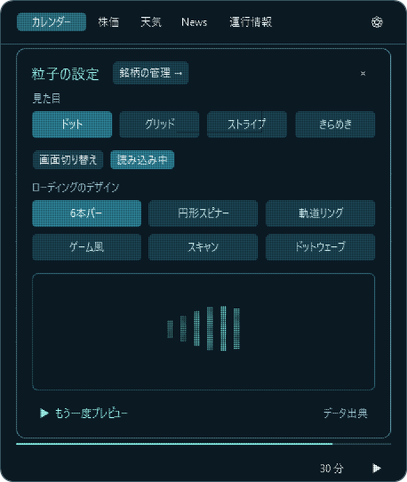

設定下部の「速度」で、画面の開閉・日付やタブの切り替え・設定パネルの粒子演出を**速い／標準／ゆっくり**から選べます。組み上がり時間の目安は約0.9秒／1.8秒／2.5秒です。閉じる演出も連動し、選択は次回起動にも保存されます。銘柄設定は粒子が組み上がった後に入力できる状態へ戻ります。

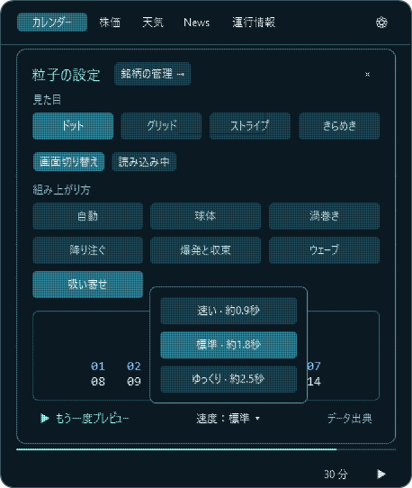

歯車から開く設定パネルでは、見た目や動きを選ぶと下の数字のプレビューがすぐに再生されます。「もう一度プレビュー」で繰り返し確認できます。

銘柄管理・検索画面の開閉、登録済み／検索の切り替え、分類・ページ移動も粒子で表示します。入力やクリックを始めたらアニメーションを終えて操作に移るため、検索欄のカーソルや文字入力はそのまま使えます。

地点の管理・検索・名前変更・位置編集の確認欄、銘柄管理、アプリ更新の画面は、**開き終わった後も粒子表示を保ちます**。文字入力・日本語変換・スクロール・ボタンの操作はそのまま使え、文字や操作状態の変化も即座に描画します。見た目は設定のドット・グリッド・ストライプ・きらめきに連動します。

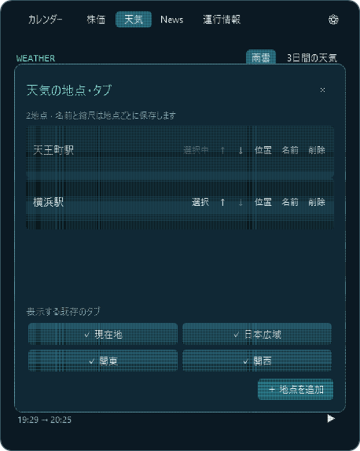

文字と数字は、表示が整った後も粒子のままです。別の画面へ切り替えると、前の配置から粒子が移動し、新しい文字やグラフを作ります。

Esc、タスクバーの時計、画面外クリックで閉じます。閉じるボタンは設けず、次に開くと前のタブを復元します。最後のタブは再起動後も引き継ぎます。閉じるときは、背景と枠も粒子の流れに合わせて右下へ縮みます。Windowsでアニメーション効果を無効にすると開閉と切り替えは即時になります。


## 株価と天気

| 株価 | 天気 |
| --- | --- |
|  |  |

株価の初期表示は **日経平均・ドル円** の2件です。株価画面の「＋」、または歯車 →「銘柄の管理」→「＋ 銘柄を追加」から、表示する銘柄を追加できます。登録済み一覧の ↑ ↓ で順番を変え、− で削除できます。登録と順序は次の起動にも引き継ぎます。増えた銘柄は株価画面の選択欄をホイールで横スクロールできます。

| 名前・愛称・コードを同じ欄で検索 | 登録済みの銘柄を管理 |
| --- | --- |
|  |  |

検索名簿は7,108件、うち投資信託は2,652件です。「オルカン」「おるかん」「0331418A」などで検索でき、全角・半角や英字の大小を吸収します。「SBI S&P500」のように空白で絞り込めます。正式名称・愛称・コードと商品種別を確認して追加します。名簿にない米国ティッカーもコードから未照合の候補として登録できます。

**SBI証券の全取扱商品を網羅・照合した名簿ではありません。** 名簿は公式の公開一覧から作成して同梱し、リリース時に更新します。検索対象と実際に価格を取得できる範囲は異なります。登録前に配信の有無を確認できます。[名簿の出典・収録範囲・更新方法](docs/market-catalog.md)

検索結果には「取得先あり・未確認」「取得確認済＋日時」「配信未確認・再確認可」を表示します。「確認」で実際にデータを取得できるか調べられます。三菱UFJアセットマネジメントの511件は公式CSVを使用し、残る2,141件にはSBI証券の公開基準価額CSVへの取得経路を追加しました。SBI・V・S&P500、SBI・V・全米株式、雪だるま、楽天・全米株式、ニッセイ外国株式、たわらノーロード先進国株式、ひふみプラスなどで実データの取得を確認しています。

**2,652件すべての配信成功を確認したという意味ではありません。** SBI側での非取扱・履歴不足・名称変更などで取得できない銘柄もあります。取得元のファンド名を照合し、別商品やETFの価格で代用しません。取得元の一時的な通信・サービスエラーと、CSVに履歴がない場合を区別して案内します。既に登録したSBI・Vシリーズなどは再登録せず取得できます。[SBI証券の公開基準価額履歴](https://site0.sbisec.co.jp/marble/fund/history/standardprice.do?fund_sec_code=89311199)（データ提供：ウエルスアドバイザー）

| ドル円 | SBI・V・S&P500の基準価額 |
| --- | --- |
|  |  |

株式・指数・為替・ETF等は初期表示で直近3か月の日足を表示します。銘柄名と価格を別の行に置き、長い名前でも価格と単位が隠れないようにしています。上部の「3 MONTHS ▾」をクリックすると、濃紺と青緑のメニューから1か月・3か月・6か月・1年・5年を選べます。5年表示は週足、それ以外は日足です。銘柄と期間の組み合わせごとに取得履歴を保持します。日経平均とS&P 500の単位はpt、ドル円は円/ドル、国内株は円、米国株はUSDです。緑は上昇、赤は下落で、ひげはその日の高値と安値です。日付・値・前日比は取得した最後の日足に対応し、配信には遅延があり得ます。[Yahoo Finance](https://finance.yahoo.com/)

投信は基準価額（1万口あたり・円）を、選択した期間の折れ線で表示します。初期値は約3か月です。株価・ETFの価格とは区別し、基準日と値を併記します。オルカンなどは運用会社の公式CSVを使用します。[三菱UFJアセットマネジメント](https://emaxis.am.mufg.jp/fund/253425.html)


雨雲は選択中の登録地点の周辺を表示します。「現在地」を選ぶとWindowsの現在地周辺を表示します。位置情報を取得できないとき、6秒以内に測位できないとき、観測範囲外のときは日本広域を表示します。日本広域・関東・関西も手動で選べます。位置情報は新しい測位結果を優先します。位置情報を取得でき、表示範囲に含まれる場合は、赤点で推定現在地を示します。Windowsから推定誤差が得られるときは、その距離を表示し、地図上にも円で表します。測位元によって誤差が生じるため、実際の位置を保証する表示ではありません。再生する時刻を変えても赤点は同じ地点を指します。自動測位した座標はディスクに保存しません。手動で指定した基準地点は、このPCのアプリ用データフォルダーに保存します。地図と雨雲の取得先へは表示範囲のタイル番号を送ります。

地図には横浜・東京・千葉などの都市名と白い目印を重ねて表示します。都道府県境は[Natural Earthの行政境界データ](https://www.naturalearthdata.com/downloads/10m-cultural-vectors/10m-admin-1-states-provinces/)を使った、控えめな細い概略線です。全国61都市の代表地点を収録し、広域では主要都市を、拡大時には周辺の都市も表示します。名前が重なる場合は位置を調整し、収まらない名前は省略します。現在地・保存地点の赤点は都市の目印とは別の表示です。地図の移動・拡大縮小に追従し、雨雲の再生中も都市名は同じ位置に表示します。代表地点は国土地理院の住所検索から取得した市役所・都庁などの位置を使用しています。


地図上のホイールで拡大縮小し、ドラッグで表示範囲を移動できます。ホイールはWindowsの「スクロールする行数」で倍率を変えず、小さな入力を1ノッチ分にまとめ、短時間の連続入力で何段階も飛ばないようにしています。ポインターの位置を基準に1段階ずつ拡縮し、縮尺はレベル4〜18です。範囲を変えると、その範囲の地図・雨雲を再取得します。「現在地」をクリックすると再測位して戻ります。保存地点を設定しているときは「保存地点」に変わり、その地点へ戻ります。

### 地点を複数登録・切り替える

1. 天気タブの「＋ 地点」、または「管理 → ＋ 地点を追加」を押します。
2. 駅名・建物名・地名・住所を2文字以上入力すると、入力が約0.65秒止まったところで自動検索します。例：`天王町駅`、`横浜ランドマークタワー`、`横浜市`、`東京都千代田区丸の内1-9-1`。日本語の変換中は待ち、確定後に検索します。「検索」やEnterでも再検索できます。
3. 候補を選ぶとその周辺の地図に移動し、橙色の点を表示します。完全一致する名前を先頭にし、候補には種類・市区町村などの所在地・基準地点からのおよその距離・取得元を表示します。「駅」「建物・施設」「地名・住所」で絞り込み、‹ › で3件ずつページを切り替えられます。文字の一致と、基準地点がある場合はその近さを考慮して並べます。同じ駅の近接した複数の候補や、同じ代表点の重複をまとめています。
4. 確認欄の「名前」には検索した候補名が入ります。駅から自宅の位置へ調整した場合などは、その場で「自宅」「職場」などへ書き換えられます。名前・位置・縮尺を確認し、「この地点を追加」で確定します。既存の登録地点は残したまま、新しい地点を追加します。候補選択だけでは保存しません。登録前に、ホイールで拡大縮小し、ドラッグで地図を移動してから、短いクリックで登録する位置を指定できます。ドラッグだけでは橙色の登録位置を動かしません。駅から離れた場所を指定する場合も、移動先をクリックしてから追加してください。名前を書き換えてから地図を移動・拡大縮小・クリックしても、入力した名前を保持します。追加するまでは既存地点の名前・座標・縮尺を変更しません。空欄のままでは登録せず、取消やタブ切り替えで編集中の名前を破棄します。雨雲・3日間予報・カレンダーの天気と気温が保存地点へ切り替わります。選んだ駅名・地名も座標と一緒に保存し、「天王町駅周辺の雨雲」のように表示します。3日間予報やカレンダーの天気のツールチップも同じ名前になり、再起動後も保持します。
5. 検索画面の「地図で指定」では従来の地図クリックを使えます。タブの「現在地」を選ぶと自動測位へ切り替わります。登録済みの地点は削除されません。「取消」やEscでは保存されません。

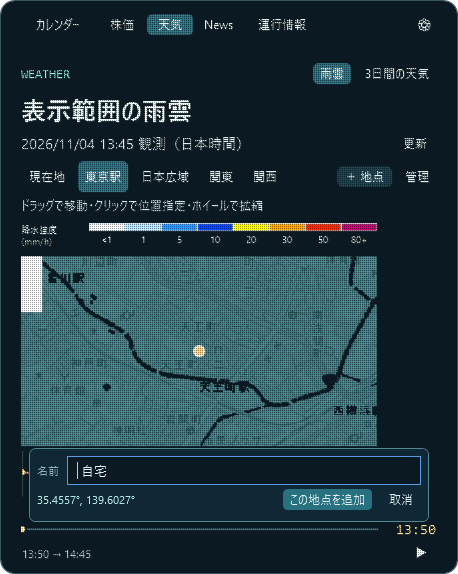

検索には[国土地理院の地名・住所検索](https://maps.gsi.go.jp/help/pdf/GSIMaps.pdf)と、建物・店舗などを補う[Photon / OpenStreetMap](https://github.com/komoot/photon)を使用します。自動検索を含め、入力した検索語をこの2つの取得元へ送信します。距離による並べ替えはPC内で行い、保存地点の座標は検索先へ送信しません。建物・店舗名は取得元に収録されているものが対象で、すべての住宅・建物を検索できるわけではありません。所在地の表示には取得元の情報と、同梱した[国土地理院の市町村コード対応表](https://maps.gsi.go.jp/js/muni.js)を使います。候補は駅・町丁目・街区などの代表点であり、住所を指定しても建物の入口や部屋の位置を保証するものではありません。見つからない場合や位置が違う場合は地図で指定してください。検索語と候補の一時キャッシュは終了時に破棄し、選択した緯度・経度・地点名・地点ごとの縮尺を、このPCのアプリ用データフォルダーに保存します。検索後に地図で微調整した場合も選んだ名前を保持します。検索を使わず地図だけで追加した地点には「地点1」などの名前を付けます。旧版で保存された名前のない地点は「保存地点」として引き継ぎ、地図だけで追加する場合も登録前に名前を変更でき、既存の地点は管理画面から変更できます。再検索の重複を避け、検索処理は1件ずつ・1秒以上の間隔で開始し、入力が変わると前の検索を取り消します。[Photonの公開サーバー](https://github.com/komoot/photon#demo-server)など無料公開の取得元を使うため、混雑・利用制限・仕様変更によって検索できない場合があります。一部だけ取得できた場合はその候補を表示し、「一部未取得」と案内します。検索中は設定に合わせた粒子ローディングを表示します。

| 駅名・地名・住所で検索 | 地図で候補を確認 |
| --- | --- |
| 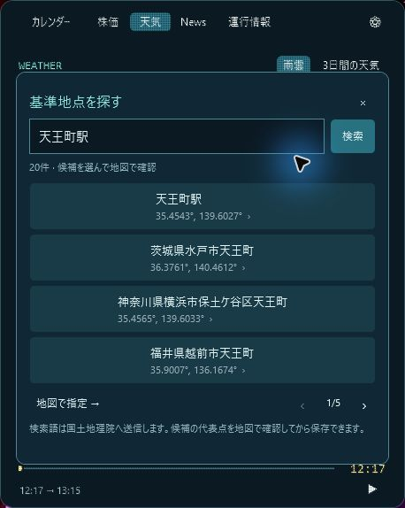 | 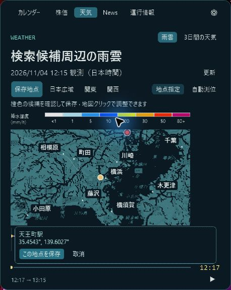 |

スクリーンショットは一時設定で公開地点を指定した動作確認画面です。実際の保存設定を変更するものではありません。

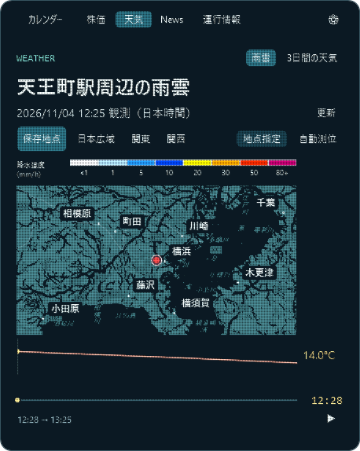

保存済みの名前は、**天気 → 管理 → 対象地点の「名前」**で編集できます。新しい名前を入力して「名前を保存」で確定します。座標・表示範囲・縮尺・雨雲の再生位置を変えず、その場で表示名を更新します。「取消」やEsc、タブ切り替えでは編集を保存しません。名前だけの変更に通信は不要で、名前のない旧保存地点にも名前を付けられます。

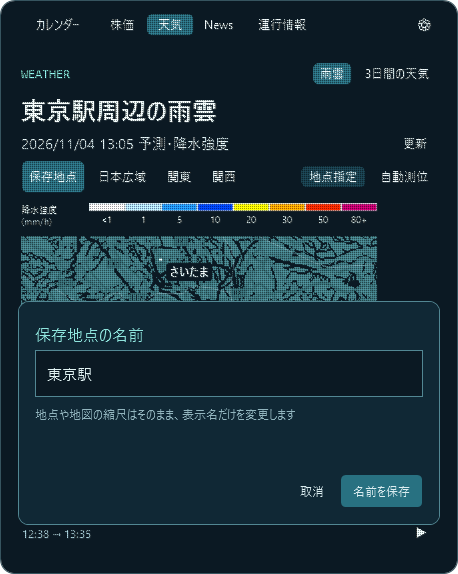

雨雲地図のホイールで変更した縮尺は、登録した地点ごとに自動保存します。「現在地」「日本広域」「関東」「関西」もそれぞれ独立して記憶します。ウィンドウの開き直し・タブ切り替え・再起動後も、各地点で選んだ縮尺を使います。新しい地点は追加時の地図の縮尺を記憶し、他の地点の縮尺を変えません。縮尺の記憶には移動後の地図の中心座標を保存せず、範囲を選び直したときはその範囲の基準位置へ戻ります。既存設定では従来と同じ初期縮尺を使います。


登録した地点は天気タブの横並びのタブから選べます。地点が多いときは、タブの上でホイールを回すと横へスクロールします。長い名前は末尾を省略し、ツールチップで全文を確認できます。雨雲と3日間予報の両方で切り替えられ、カレンダーの天気と気温も最後に選んだ地点を基準にします。選択地点も再起動後に保持します。

「管理」では地点の選択・並べ替え・位置と縮尺の編集・名前変更・削除と、既存タブの表示設定をまとめています。各地点の「↑」「↓」で上下に移動すると、天気タブの左からの並び順もその場で変わり、再起動後も保持します。並べ替えで選択中の地点・名前・座標・縮尺は変わりません。「表示する既存のタブ」の「現在地」「日本広域」「関東」「関西」を押すと非表示になり、もう一度押すと戻ります。登録地点があれば既存タブをすべて非表示にできます。登録地点の削除は「削除 → 削除する」の2回で確定し、選択中の地点を削除すると残っている地点へ切り替えます。すべての地点を削除した場合は「現在地」を使える状態に戻します。

登録済み地点の位置と縮尺は、**天気 → 管理 → 対象地点の「位置」**で変更できます。ホイールで拡大縮小、ドラッグで地図を移動し、短いクリックで登録位置を指定して「変更を保存」で確定します。名前は編集欄で固定し、地点のID・タブの並び順・選択中の地点を保持します。新しい地点は追加されません。取消やEscでは保存せず、元の地図表示に戻します。保存に失敗した場合も元の登録内容と編集内容を保持して再試行できます。選択中の地点を変更した場合は、雨雲・3日間予報・カレンダーの天気の基準位置を更新します。

位置・縮尺の調整中は、表示に必要な雨雲画像1枚だけを取得し、1時間分の予報や気温の再取得を待たずに操作できるようにしました。地図部分の粒子の移動と確認欄の出現は約0.25秒、ホイールの操作待ちは約0.12秒に短縮しています。読み込み中は元の地図を残し、地図上だけに設定済みのローディングを2倍の速さで表示します。通常の雨雲画面へ戻ると1時間分の再生を復元します。通常の予報画像取得も最大3枚ずつ並行して読み込みます。実際の通信待ち時間は回線や配信元の応答に依存します。

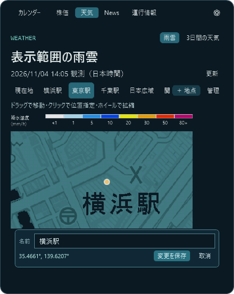

旧版の1地点分の名前・座標・縮尺を最初の登録地点として引き継ぎます。管理情報の保存に失敗した場合は、直前の登録内容を保持して再試行できるようにします。

| 複数地点の切り替え | 地点と既存タブの管理 |
| --- | --- |
| 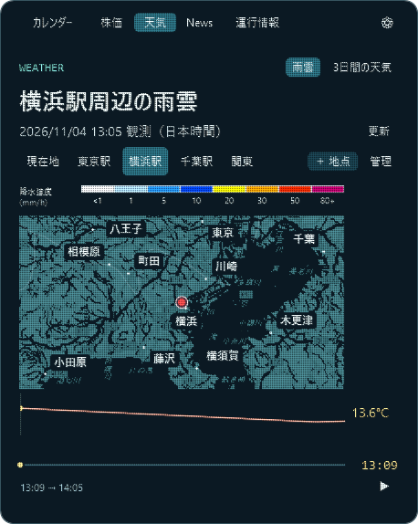 | 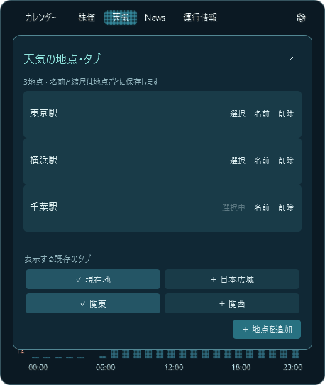 |

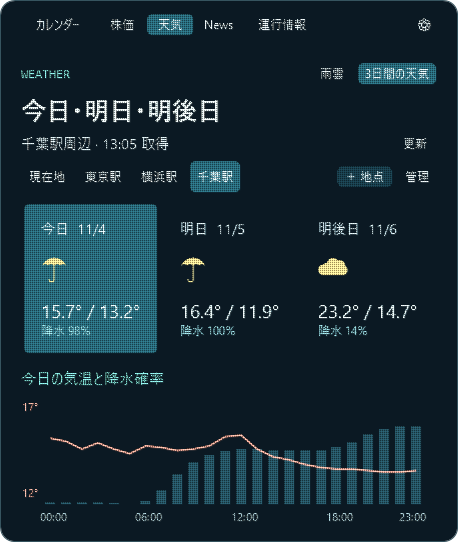

地図は縮尺レベル4～18まで拡大縮小できます。登録前の細かい位置合わせでは建物や道路を確認できる詳しい地図を使い、追加時の縮尺をその地点に保存します。雨雲画像は配信元の縮尺レベル10までの画像を拡大して合わせるため、拡大しても元の雨雲データ以上に細かな予報になるわけではありません。奇数の縮尺では対応する偶数段階の親画像を切り出して使用します。v1.28.0では、奇数段階のURLが透明画像を返して雨雲が消える問題を修正しました。広域・詳細それぞれの元データの解像度によって雨域の細かな形の見え方は変わります。

| 管理画面で順番を変更 | 建物名検索と所在地の表示 |
| --- | --- |
| 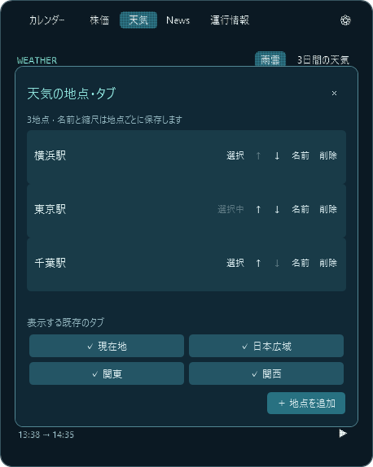 | 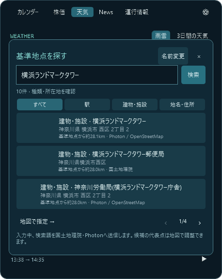 |

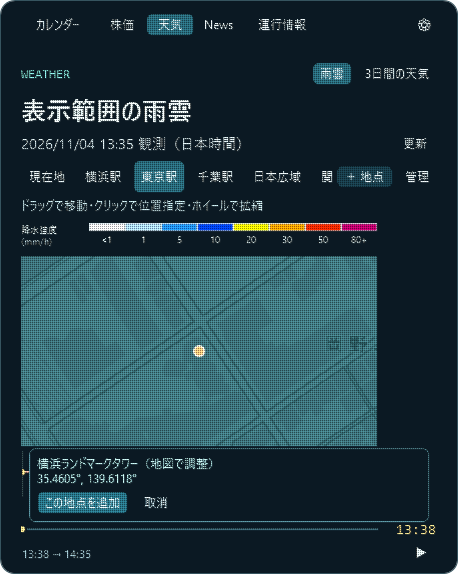

### 天気：雨雲と3日間の予報

天気タブ右上の「雨雲」「3日間の天気」で表示を切り替えます。更新ボタンは地点・取得時刻と同じ行に配置し、3日間予報とNewsの空いていた操作行を省きました。雨雲では表示範囲と地点操作を1行にまとめています。**雨雲地図と降水強度の凡例は横414pxへ広げ、下の気温グラフ・再生バーは従来の356pxの幅を保ちます**。時刻と気温はその右の余白に表示します。操作説明はツールチップにまとめています。雨雲は **最新観測から、現在を基準に最大1時間先まで** の範囲です。配信された高解像度降水ナウキャストの実画像だけを使い、5分単位で地図を切り替えます。配信の時差により、実際に取得できる終了時刻は現在から1時間より手前になります。画面下にその範囲を表示します。

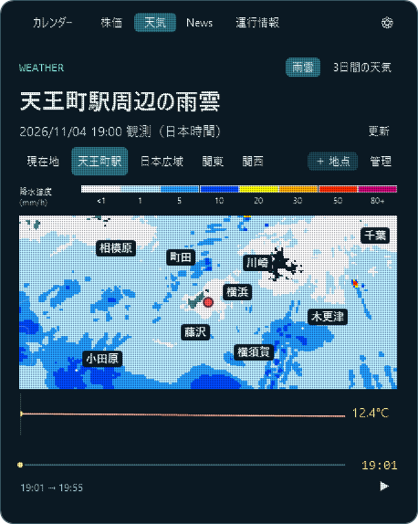

| 雨雲と気温の推移 | 最後の予測時刻 |
| --- | --- |
|  |  |

再生は約15秒で選択時刻から最後まで進み、**一度だけ再生して停止**します。最後で再生を押すと先頭から再生します。ゲージの直接クリックやドラッグで任意の時刻を選べ、その際は再生を停止します。つまみと気温グラフの目印は滑らかに移動しますが、雨雲画像は選んだ時刻以前の最新の5分フレームを保持します。ゲージ右側は選択時刻、地図上部は実際の画像の観測・予測時刻です。

雨雲の下には、保存地点（なければWindowsの現在地）周辺の気温グラフを表示します。**Open-Meteoの時間別予報を直線補間した表示**であり、分単位の実測値ではありません。広域表示や地図移動でも気温は基準地点の値です。位置が得られない場合、雨雲は日本広域、気温と3日間予報は東京を使い、その旨を表示します。気温の取得に失敗しても雨雲は操作できます。[Open-Meteoの予報仕様](https://open-meteo.com/en/docs)


「3日間の天気」では今日・明日・明後日の天気アイコン、最高・最低気温、降水確率を表示します。日付のカードをクリックすると、その日の気温の線と降水確率の棒グラフに切り替わります。保存地点を変えると、この予報・雨雲・カレンダーの天気も同じ地点を使います。気温・3日間予報の取得時には基準地点の緯度経度（小数点以下6桁）をOpen-Meteoへ送信します。予報は15分、雨雲は5分を目安に表示中に更新し、「更新」で再取得できます。無料・非商用のOpen-Meteo APIを使用しています。[データ・CC BY 4.0](https://open-meteo.com/en/licence)

降水の凡例は、地図の色と一致する横長の8段階の色付きバーです。1未満・1・5・10・20・30・50・80以上、単位は降水強度（mm/h）です。[気象庁の凡例](https://www.jma.go.jp/bosai/nowc/images/legend_jp_normal_hrpns.svg)に対応しています。予測が全く取得できないときは最新観測だけを表示し、その旨を案内します。未取得の範囲を「雨なし」として扱わず、タイルがない範囲は斜線で表示します。[雨雲の動き・気象庁](https://www.jma.go.jp/bosai/nowc/) · [背景地図・国土地理院（色を加工）](https://maps.gsi.go.jp/development/ichiran.html)

株価も表示中に5分ごとに更新します。投信は営業日ごとに更新される基準価額のため、取得するたび値が変わるとは限りません。

## Newsと運行情報

| News | 運行情報 |
| --- | --- |
|  |  |

Newsは右上の「総合」「経済」「IT」から選び、**タイトル・画像・短い説明を1記事ずつ**表示します。カード全体をクリックすると次の記事へ進み、最後からは先頭に戻ります。‹ / › でも前後の記事に移動できます。画像と説明はRSSまたは記事ページの公開プレビュー情報を使い、画像や説明が取得できない場合はその旨を表示します。出典と配信時刻をカード内に記載し、本文全体は取得・転載しません。表示中は10分ごとに更新します。総合は[NHKのRSS](https://news.web.nhk/n-data/conf/na/rss/cat0.xml)、経済は[Yahoo!ニュースのRSS](https://news.yahoo.co.jp/rss/topics/business.xml)、ITは[ITmedia NEWSのRSS](https://rss.itmedia.co.jp/rss/2.0/news_bursts.xml)です。

運行情報の対象は相鉄線、JR横須賀線・東海道線・京浜東北線・湘南新宿ライン、東急東横線・東急新横浜線の7路線です。**遅延・運転見合わせなど、運行情報がある路線だけ**を表示し、平常運転の路線は個別に並べず、確認した対象路線に問題がなければ「現在、運行に大きな乱れはありません」と表示します。「近隣」「JR」「私鉄」で絞り込み、表示が多いときは‹ / ›でページを切り替えられます。対象範囲は横浜周辺で固定です。表示中は5分ごとに更新し、路線をクリックすると公式ページへ進めます。

取得元は[相模鉄道](https://www.sotetsu.co.jp/train/status/)、[JR東日本](https://traininfo.jreast.co.jp/train_info/kanto.aspx)、[東急電鉄](https://www.tokyu.co.jp/unten2/unten.html)の公開運行情報です。各社の遅延掲載基準に従うため、掲載がなくても小さな遅延を含む場合があります。画面上部はアプリが確認した時刻、各行の「発表」は取得元が提供する更新時刻です。取得元に時刻がない場合も明記します。情報を取得できない路線は「取得できなかった路線」として名前を表示します。遅延情報がある場合も、未取得路線の案内を一緒に表示します。名前は「近隣／JR／私鉄」の絞り込みに連動し、長い一覧はツールチップで全文を確認できます。前回の情報を残す場合は更新失敗と確認時刻を表示し、今回確認できなかった対象路線名を示します。


株価・天気・News・運行情報の下部リンクは省きました。取得元と地図などの出典は、歯車 →「データ出典」から確認できます。

## 回転する地球

カレンダー上部は実際の大陸の形を点で描いた地球です。‹ 今日 › のボタンを右端、地球をその左に配置しています。自転に合わせて大陸の見え方が変わり、奥行きに応じて点の明るさも変化します。カレンダーを閉じている間は回転を休止します。Windowsのアニメーション効果を無効にしている場合は静止表示です。[地形データ・Natural Earth](https://www.naturalearthdata.com/about/terms-of-use/)

## タイマー


時間表示をクリックすると、カレンダー内に時間選択パネルが開きます。1〜180分の候補から選び、隣の▶で開始します。初期値は30分です。■で停止でき、時間の選択は次のタイマーから適用され、作動中の残り時間表示を置き換えません。

タイマー中は、残り時間・再生／停止ボタンと同じ行の左側にゲージが粒子で現れ、経過時間に応じて伸びます。時間とボタンの幅を確保し、12pxの間隔を挟んだ残りの横幅をすべてゲージに使います（標準表示で約308px）。180分の表示でも重なりません。右側の再生・停止ボタンの位置は、ゲージの表示・非表示によって動きません。ウィンドウを閉じても、粒子で描いた小窓に残り時間を表示します。小窓は時間の桁数に合わせて幅を調整し、数字と右のバーの間の余白を抑えています。左の砂時計は経過時間に合わせて上の砂が減り、下の砂が増え、砂粒が落ちるアニメーションを表示します。小窓右端のゲージも連動します。小窓をクリックすると前のタブに戻り、終了時には音とWindows通知で知らせます。


## 起動と終了

`OrbitCalendar.exe` をダウンロードしてダブルクリックします。インストール不要で、Windows 11と.NET Framework 4.8以降を使用します。

**Windowsへのサインイン時の自動起動**は、歯車の設定上部にある「自動起動 OFF」を押してONにします。日時や通知領域アイコンの右クリックメニューからも切り替えられます。初期状態はOFFで、ONにしたユーザーのサインイン時に右下の時計として起動し、カレンダーのウィンドウは自動では開きません。OFFにするとこのアプリの自動起動登録を解除します。exeの保存場所を決めてからONにし、exeを移動した場合は新しい場所でOFF→ONにし直してください。

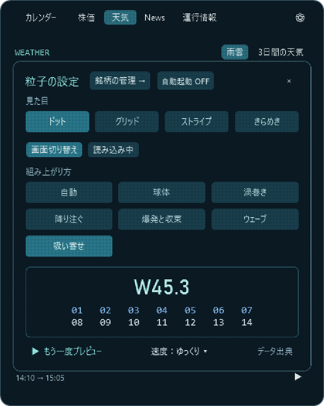

### アプリ内で更新する

**v1.27.0以降は、起動時と、その後6時間ごとにGitHubの最新の正式版を自動確認**します。ウィンドウを閉じていても確認し、スリープ中に確認時刻を過ぎた場合は復帰後の確認にまとめます。通信に失敗した場合は1時間後に再試行し、前回見つかった更新の表示は保持します。自動でダウンロード・再起動することはありません。

**歯車内の「更新」は新しい版が見つかった場合だけ表示**します。更新がない場合は表示せず、更新画面内の「更新して再起動」も非表示にします。日時・通知領域アイコンの右クリック →「更新を確認…」では、いつでも手動で確認できます。手動確認と定期確認が重なった場合は同じ通信を共有します。

| 更新なし | 更新あり（表示例） |
| --- | --- |
| 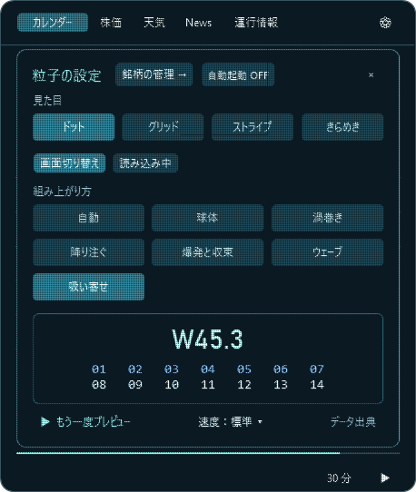 | 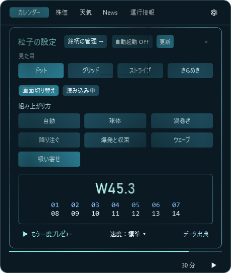 |

「更新して再起動」を押すと、ダウンロード・検証後に同じ場所のexeを置き換え、自動で再起動します。ダウンロードは画面を閉じると中止できます。更新の確認は背景で続け、差し替えを始めた後は再起動までお待ちください。

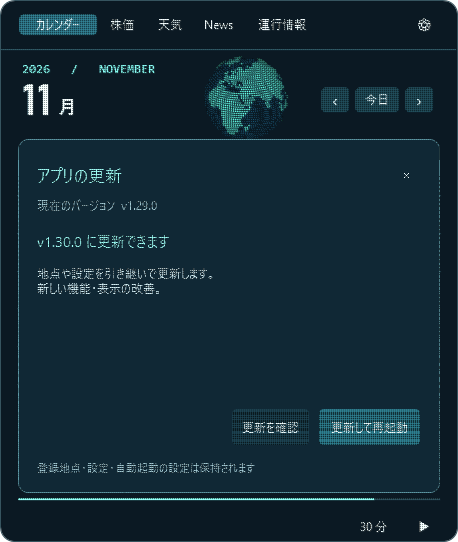

登録地点・名前・順序・位置・縮尺、銘柄、表示設定を保存する `%LOCALAPPDATA%\OrbitCalendar` は変更しません。exeのパスを維持するため、自動起動のON/OFFとWindowsの登録先もそのままです。更新による再起動で実行中のタイマーは終了します。

更新ファイルはこのリポジトリの正式リリースから取得し、GitHubが返すSHA-256、サイズ、アプリ名、バージョンを照合します。保存先への書き込みを確認してから終了し、新しいアプリの起動を確認できなければ元のexeに戻して起動します。書き込みできないフォルダーではエラーを表示し、起動中のアプリを維持します。[更新情報と検証値の仕様・GitHub Releases API](https://docs.github.com/en/rest/releases/releases)

この機能は **v1.26.0以降**で使用できます。古い版を使っている別PCでは、初回だけアプリを終了し、[最新版のexe](https://github.com/NaitoMitsuharu/OrbitCalendar/releases/latest/download/OrbitCalendar.exe)を同じ場所に上書きして起動してください。以降はアプリ内から更新できます。

タスクバーの時刻か日付をクリックして開きます。日時の位置を検出できない構成では、通知領域の惑星アイコンから開けます。日時または惑星アイコンを右クリックし、「Orbit Calendar を終了」で終了します。標準の通知センターは Win+N から開けます。

株価・天気（雨雲・3日間予報）・News・運行情報の取得中は、選択したローディング専用デザインを粒子で表示します。標準は6本の縦バーが順に伸縮する表示です。円形スピナーの回転する光の尾、軌道を回る粒子、立体的に回転するドットキューブ、パズルのようなタイル組み替え、ドットの波も選べます。実際の取得率を表す百分率は使わず、取得中は繰り返し動きます。取得後は動いていた粒子から内容を組み上げます。ニュースの画像欄にも同じデザインを使います。Windowsでアニメーションを無効にしている場合は静止した表示にします。タブ切り替えや画面を閉じたときは終了し、更新失敗や未取得の路線がある場合はその状態を表示します。

デザインの参考：[CSS Loaders・バー](https://css-loaders.com/bars/)・[円形](https://css-loaders.com/spinner/)、[UI Ball LDRS](https://uiball.com/ldrs/)。アプリの粒子描画に合わせて実装しています。

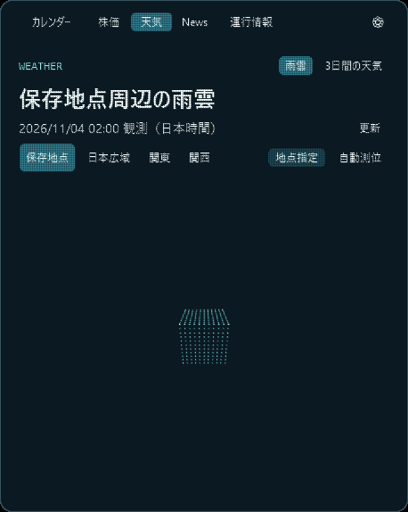

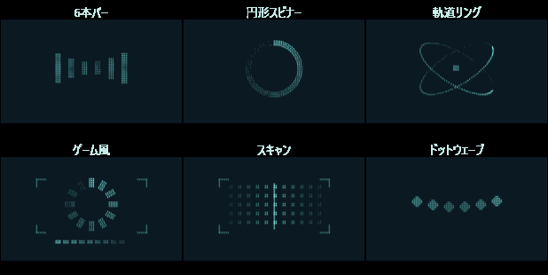

## UI確認

[UIレビューの確認内容と修正点](docs/ui-review.md)

カレンダー・粒子設定・時間選択・統合検索・登録管理・日経平均・ドル円・オルカン・雨雲・3日間予報・News・運行情報を確認しています。操作中に内容が動かないホバー枠、濃紺と青緑のツールチップ、無効なボタンの表示、長い文の省略表示と折り返すツールチップを共通化しています。タイマーの実行中に時間を選び直すと、次回のタイマーに適用されることをパネル内で案内します。

## ビルド

Windowsの64ビット環境でリポジトリのルートから実行します。

```powershell
powershell -NoProfile -ExecutionPolicy Bypass -File .\build.ps1
.\build\OrbitCalendar.exe
```

バージョンは `version.txt` からexeに埋め込みます。実行中のアプリとは別の出力先で確認する場合は `-OutputDirectory build/next` を指定できます。更新機能の確認は `tools/verify-updater.ps1`、画面の確認は `tools/verify-update-ui.ps1`（Windows PowerShell・STA）、定期確認の確認は `tools/verify-update-monitor.ps1` です。時計を進めて6時間の周期・失敗後の再試行・スリープ復帰・終了時の処理を確認できます。テスト用アプリ・保存先を用意し、実際の自動起動登録は変更しません。

メニューの粒子表示はソフトウェア描画にも対応したPS 2.0を同梱しています。[WPF ShaderEffectの仕様](https://learn.microsoft.com/en-us/dotnet/api/system.windows.media.effects.shadereffect)。描画を変更した場合は `tools/compile-menu-particles.ps1` で `src/menu-particles.hlsl` から再生成し、通常のビルドでexeに埋め込みます。メニューの常時粒子表示と入力・操作は `tools/verify-particle-menus.ps1`（Windows PowerShell・STA）で確認できます。

粒子表現は @nomotech さんの作品を参考にしています。[画面の組み替え](https://x.com/nomotech/status/2087916696455795123) · [地球儀](https://x.com/nomotech/status/2087515108713111556) · [株価と雨雲](https://x.com/nomotech/status/2087917639263993951)
