# Orbit Calendar

Windowsのタスクバー内の日時から開く、粒子でできたカレンダー・株価・天気・ニュース・運行情報ビューアです。

[Windows版をダウンロード](https://github.com/NaitoMitsuharu/OrbitCalendar/releases/latest/download/OrbitCalendar.exe) · [リリース一覧](https://github.com/NaitoMitsuharu/OrbitCalendar/releases)

## カレンダー

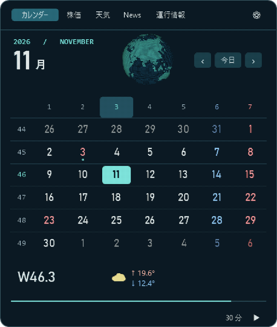

月曜始まりです。左にISO週番号、上に曜日番号（月曜1〜日曜7）を表示し、選択日に対応する番号を青緑で強調します。土曜は青、日曜・日本の祝日・休日は赤です。日付を選ぶと下部に `W45.2` のような週・曜日番号と祝日名を表示します。

日付をクリックすると、選択枠・週番号・曜日番号・下部の日付など、変わる部分の粒子が組み替わります。地球や今日の天気はそのまま保ちます。カレンダー上でスクロールすると月が変わります。‹ / › または Page Up / Page Down でも移動でき、「今日」または Home で今日を選べます。下部の細いゲージは選択日の年内の進み具合で、12月31日に右端に届きます。

週・曜日表示（例：W45.2）は左に置き、中央に基準地点周辺の今日の天気アイコンと最高気温（↑）・最低気温（↓）を表示します。保存地点があればその場所を使い、なければWindowsの現在地を使います。位置情報が得られない場合は東京の予報を使い、ツールチップでその旨を示します。予報を取得できない場合は◌と—になります。天気と気温の取得には、基準地点の緯度・経度を小数点以下6桁でOpen-Meteoへ送ります。[天気予報・Open-Meteo](https://open-meteo.com/)

祝日は1955〜2027年分を同梱しています。起動中に1日1回、内閣府のCSVを確認し、新しく公表された年や変更を取り込みます。通信できないときは保存済みデータを使用し、1時間後に再試行します。未公表の年は曜日で色分けします。[出典・内閣府「国民の祝日」](https://www8.cao.go.jp/chosei/shukujitsu/gaiyou.html)

## 粒子と開閉


右上の歯車で粒子の見た目をドット・グリッド・ストライプ・きらめきから選べます。標準は「吸い寄せ」です。粒子は円周に揃えず、中心まで広がる雲状の配置から数字や文字の輪郭へ集まり、遅れて内側の隙間を埋めます。月送りでは、日付・週番号・月名などが変わる部分の粒子が次の配置へ移動します。地球・天気アイコン・タブなどは散らばらず、地球の自転も続きます。球体・渦巻き・降り注ぐ・爆発と収束・ウェーブも選択でき、「自動で切り替え」では異なる動きを順に使います。設定は次の起動にも引き継ぎます。

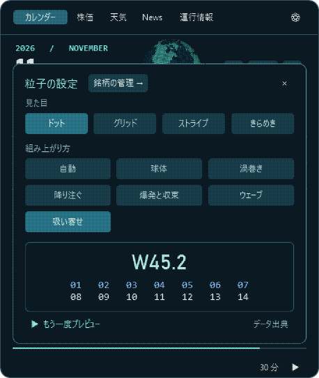

歯車から開く設定パネルでは、見た目や動きを選ぶと下の数字のプレビューがすぐに再生されます。「もう一度プレビュー」で繰り返し確認できます。

銘柄管理・検索画面の開閉、登録済み／検索の切り替え、分類・ページ移動も粒子で表示します。入力やクリックを始めたらアニメーションを終えて操作に移るため、検索欄のカーソルや文字入力はそのまま使えます。

文字と数字は、表示が整った後も粒子のままです。別の画面へ切り替えると、前の配置から粒子が移動し、新しい文字やグラフを作ります。

Esc、タスクバーの時計、画面外クリックで閉じます。閉じるボタンは設けず、次に開くと前のタブを復元します。最後のタブは再起動後も引き継ぎます。閉じるときは、背景と枠も粒子の流れに合わせて右下へ縮みます。Windowsでアニメーション効果を無効にすると開閉と切り替えは即時になります。

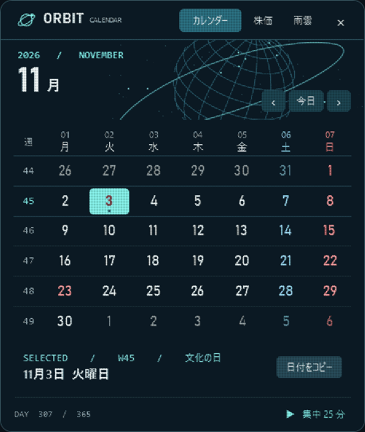

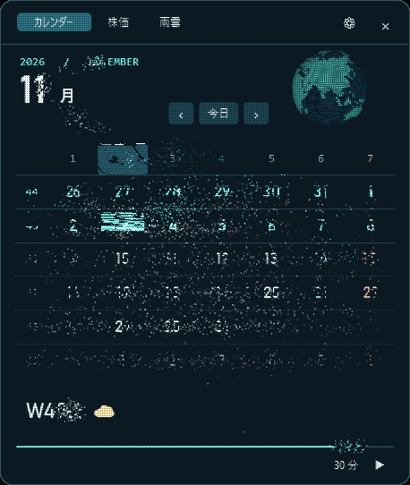

## 株価と天気

| 株価 | 天気 |
| --- | --- |
|  | 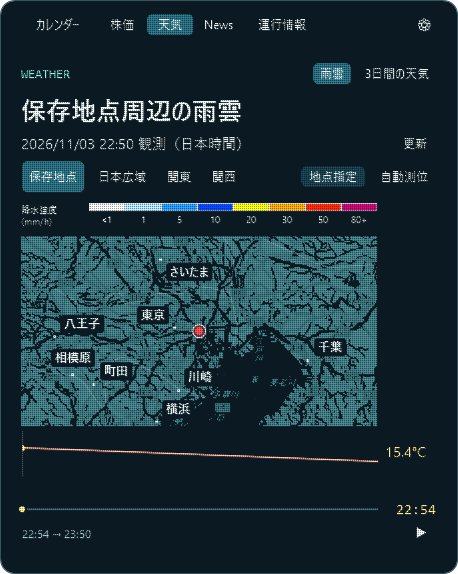 |

株価の初期表示は **日経平均・ドル円** の2件です。株価画面の「＋」、または歯車 →「銘柄の管理」→「＋ 銘柄を追加」から、表示する銘柄を追加できます。登録済み一覧の ↑ ↓ で順番を変え、− で削除できます。登録と順序は次の起動にも引き継ぎます。増えた銘柄は株価画面の選択欄をホイールで横スクロールできます。

| 名前・愛称・コードを同じ欄で検索 | 登録済みの銘柄を管理 |
| --- | --- |
| 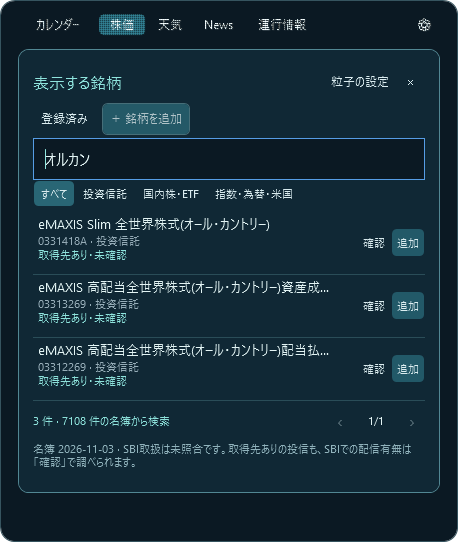 | 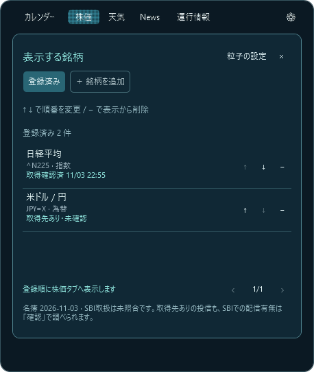 |

検索名簿は7,108件、うち投資信託は2,652件です。「オルカン」「おるかん」「0331418A」などで検索でき、全角・半角や英字の大小を吸収します。「SBI S&P500」のように空白で絞り込めます。正式名称・愛称・コードと商品種別を確認して追加します。名簿にない米国ティッカーもコードから未照合の候補として登録できます。

**SBI証券の全取扱商品を網羅・照合した名簿ではありません。** 名簿は公式の公開一覧から作成して同梱し、リリース時に更新します。検索対象と実際に価格を取得できる範囲は異なります。登録前に配信の有無を確認できます。[名簿の出典・収録範囲・更新方法](docs/market-catalog.md)

検索結果には「取得先あり・未確認」「取得確認済＋日時」「配信未確認・再確認可」を表示します。「確認」で実際にデータを取得できるか調べられます。三菱UFJアセットマネジメントの511件は公式CSVを使用し、残る2,141件にはSBI証券の公開基準価額CSVへの取得経路を追加しました。SBI・V・S&P500、SBI・V・全米株式、雪だるま、楽天・全米株式、ニッセイ外国株式、たわらノーロード先進国株式、ひふみプラスなどで実データの取得を確認しています。

**2,652件すべての配信成功を確認したという意味ではありません。** SBI側での非取扱・履歴不足・名称変更などで取得できない銘柄もあります。取得元のファンド名を照合し、別商品やETFの価格で代用しません。取得元の一時的な通信・サービスエラーと、CSVに履歴がない場合を区別して案内します。既に登録したSBI・Vシリーズなどは再登録せず取得できます。[SBI証券の公開基準価額履歴](https://site0.sbisec.co.jp/marble/fund/history/standardprice.do?fund_sec_code=89311199)（データ提供：ウエルスアドバイザー）

| ドル円 | SBI・V・S&P500の基準価額 |
| --- | --- |
|  | 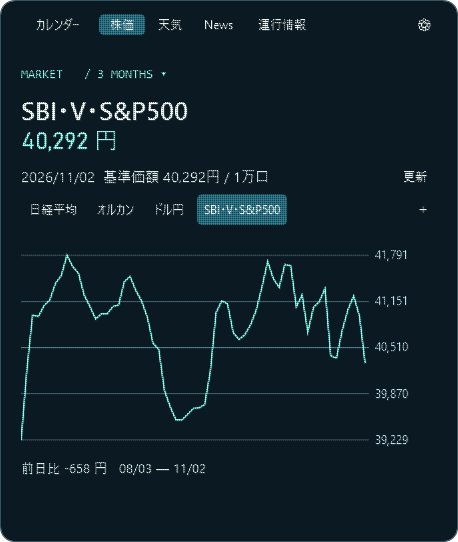 |

株式・指数・為替・ETF等は初期表示で直近3か月の日足を表示します。銘柄名と価格を別の行に置き、長い名前でも価格と単位が隠れないようにしています。上部の「3 MONTHS ▾」をクリックすると、濃紺と青緑のメニューから1か月・3か月・6か月・1年・5年を選べます。5年表示は週足、それ以外は日足です。銘柄と期間の組み合わせごとに取得履歴を保持します。日経平均とS&P 500の単位はpt、ドル円は円/ドル、国内株は円、米国株はUSDです。緑は上昇、赤は下落で、ひげはその日の高値と安値です。日付・値・前日比は取得した最後の日足に対応し、配信には遅延があり得ます。[Yahoo Finance](https://finance.yahoo.com/)

投信は基準価額（1万口あたり・円）を、選択した期間の折れ線で表示します。初期値は約3か月です。株価・ETFの価格とは区別し、基準日と値を併記します。オルカンなどは運用会社の公式CSVを使用します。[三菱UFJアセットマネジメント](https://emaxis.am.mufg.jp/fund/253425.html)

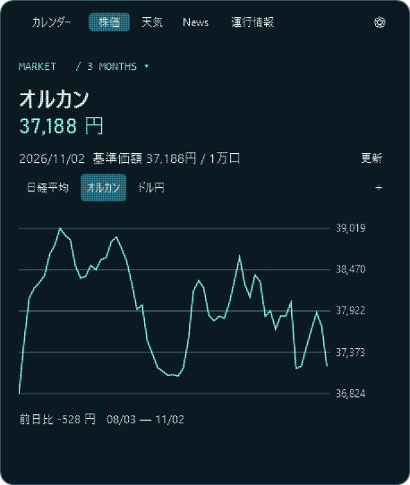

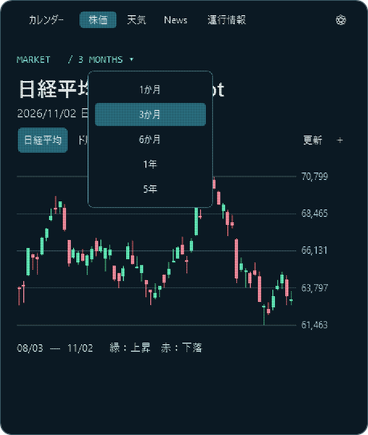

雨雲は保存した基準地点の周辺を表示します。保存地点がなければWindowsの現在地周辺を表示します。位置情報を取得できないとき、6秒以内に測位できないとき、観測範囲外のときは日本広域を表示します。日本広域・関東・関西も手動で選べます。位置情報は新しい測位結果を優先します。位置情報を取得でき、表示範囲に含まれる場合は、赤点で推定現在地を示します。Windowsから推定誤差が得られるときは、その距離を表示し、地図上にも円で表します。測位元によって誤差が生じるため、実際の位置を保証する表示ではありません。再生する時刻を変えても赤点は同じ地点を指します。自動測位した座標はディスクに保存しません。手動で指定した基準地点は、このPCのアプリ用データフォルダーに保存します。地図と雨雲の取得先へは表示範囲のタイル番号を送ります。

地図には横浜・東京・千葉などの都市名と白い目印を重ねて表示します。都道府県境は[Natural Earthの行政境界データ](https://www.naturalearthdata.com/downloads/10m-cultural-vectors/10m-admin-1-states-provinces/)を使った、控えめな細い概略線です。全国61都市の代表地点を収録し、広域では主要都市を、拡大時には周辺の都市も表示します。名前が重なる場合は位置を調整し、収まらない名前は省略します。現在地・保存地点の赤点は都市の目印とは別の表示です。地図の移動・拡大縮小に追従し、雨雲の再生中も都市名は同じ位置に表示します。代表地点は国土地理院の住所検索から取得した市役所・都庁などの位置を使用しています。

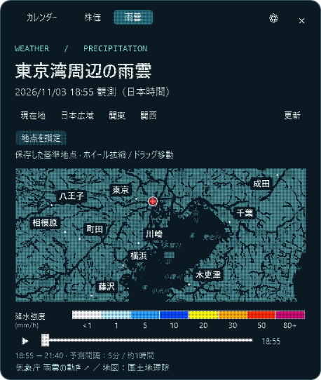

地図上のホイールで拡大縮小し、ドラッグで表示範囲を移動できます。範囲を変えると、その範囲の地図・雨雲を再取得します。「現在地」をクリックすると再測位して戻ります。保存地点を設定しているときは「保存地点」に変わり、その地点へ戻ります。

### 基準地点を補正・保存する

1. 雨雲の地図を拡大・移動して、指定したい場所を表示します。
2. 「地点指定」を押し、地図上の場所をクリックします。候補の地点が橙色の点で表示されます。
3. 座標を確認し、「この地点を保存」を押します。雨雲と今日の天気アイコンがその地点へ切り替わり、再起動後も使います。
4. 「自動測位」で保存地点を解除できます。「取消」やEscでは保存されません。

| 地点の候補を確認 | 保存した地点を使用 |
| --- | --- |
| 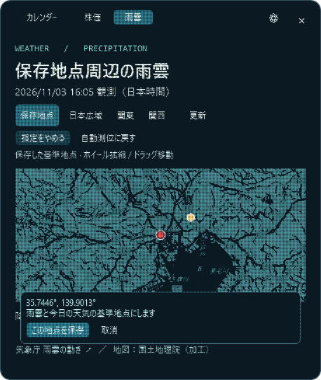 | 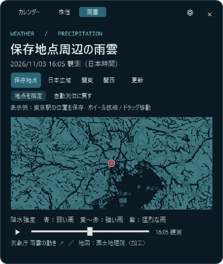 |

### 天気：雨雲と3日間の予報

天気タブ右上の「雨雲」「3日間の天気」で表示を切り替えます。更新ボタンは地点・取得時刻と同じ行に配置し、3日間予報とNewsの空いていた操作行を省きました。雨雲では表示範囲と地点操作を1行にまとめています。地図・気温グラフ・再生バーの左右の端を揃え、時刻と気温は右の余白に表示します。降水強度の小さな凡例は地図の上に置いています。操作説明はツールチップにまとめています。雨雲は **最新観測から、現在を基準に最大1時間先まで** の範囲です。配信された高解像度降水ナウキャストの実画像だけを使い、5分単位で地図を切り替えます。配信の時差により、実際に取得できる終了時刻は現在から1時間より手前になります。画面下にその範囲を表示します。

| 雨雲と気温の推移 | 最後の予測時刻 |
| --- | --- |
|  | 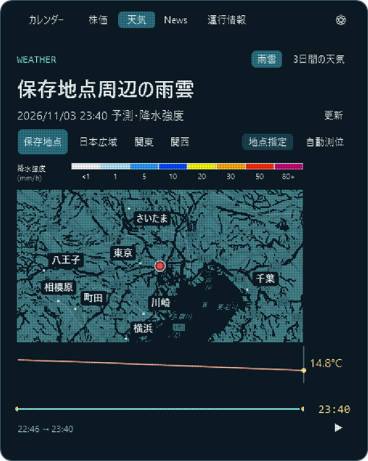 |

再生は約15秒で選択時刻から最後まで進み、**一度だけ再生して停止**します。最後で再生を押すと先頭から再生します。ゲージの直接クリックやドラッグで任意の時刻を選べ、その際は再生を停止します。つまみと気温グラフの目印は滑らかに移動しますが、雨雲画像は選んだ時刻以前の最新の5分フレームを保持します。ゲージ右側は選択時刻、地図上部は実際の画像の観測・予測時刻です。

雨雲の下には、保存地点（なければWindowsの現在地）周辺の気温グラフを表示します。**Open-Meteoの時間別予報を直線補間した表示**であり、分単位の実測値ではありません。広域表示や地図移動でも気温は基準地点の値です。位置が得られない場合、雨雲は日本広域、気温と3日間予報は東京を使い、その旨を表示します。気温の取得に失敗しても雨雲は操作できます。[Open-Meteoの予報仕様](https://open-meteo.com/en/docs)

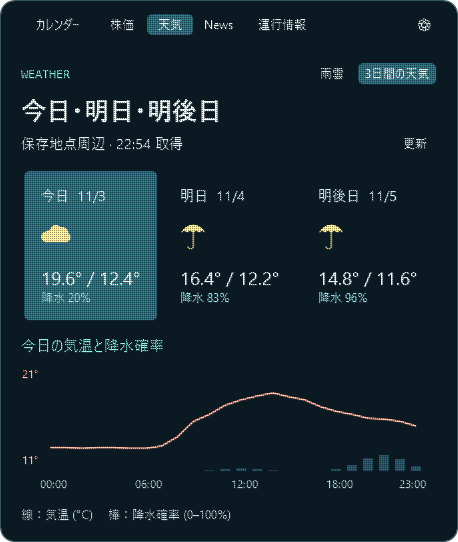

「3日間の天気」では今日・明日・明後日の天気アイコン、最高・最低気温、降水確率を表示します。日付のカードをクリックすると、その日の気温の線と降水確率の棒グラフに切り替わります。保存地点を変えると、この予報・雨雲・カレンダーの天気も同じ地点を使います。気温・3日間予報の取得時には基準地点の緯度経度（小数点以下6桁）をOpen-Meteoへ送信します。予報は15分、雨雲は5分を目安に表示中に更新し、「更新」で再取得できます。無料・非商用のOpen-Meteo APIを使用しています。[データ・CC BY 4.0](https://open-meteo.com/en/licence)

降水の凡例は、地図の色と一致する横長の8段階の色付きバーです。1未満・1・5・10・20・30・50・80以上、単位は降水強度（mm/h）です。[気象庁の凡例](https://www.jma.go.jp/bosai/nowc/images/legend_jp_normal_hrpns.svg)に対応しています。予測が全く取得できないときは最新観測だけを表示し、その旨を案内します。未取得の範囲を「雨なし」として扱わず、タイルがない範囲は斜線で表示します。[雨雲の動き・気象庁](https://www.jma.go.jp/bosai/nowc/) · [背景地図・国土地理院（色を加工）](https://maps.gsi.go.jp/development/ichiran.html)

株価も表示中に5分ごとに更新します。投信は営業日ごとに更新される基準価額のため、取得するたび値が変わるとは限りません。

## Newsと運行情報

| News | 運行情報 |
| --- | --- |
|  | 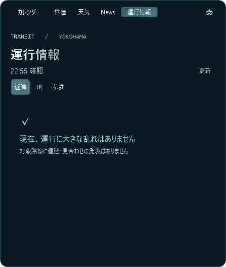 |

Newsは右上の「総合」「経済」「IT」から選び、**タイトル・画像・短い説明を1記事ずつ**表示します。カード全体をクリックすると次の記事へ進み、最後からは先頭に戻ります。‹ / › でも前後の記事に移動できます。画像と説明はRSSまたは記事ページの公開プレビュー情報を使い、画像や説明が取得できない場合はその旨を表示します。出典と配信時刻をカード内に記載し、本文全体は取得・転載しません。表示中は10分ごとに更新します。総合は[NHKのRSS](https://news.web.nhk/n-data/conf/na/rss/cat0.xml)、経済は[Yahoo!ニュースのRSS](https://news.yahoo.co.jp/rss/topics/business.xml)、ITは[ITmedia NEWSのRSS](https://rss.itmedia.co.jp/rss/2.0/news_bursts.xml)です。

運行情報の対象は相鉄線、JR横須賀線・東海道線・京浜東北線・湘南新宿ライン、東急東横線・東急新横浜線の7路線です。**遅延・運転見合わせなど、運行情報がある路線だけ**を表示し、平常運転の路線は個別に並べず、確認した対象路線に問題がなければ「現在、運行に大きな乱れはありません」と表示します。「近隣」「JR」「私鉄」で絞り込み、表示が多いときは‹ / ›でページを切り替えられます。対象範囲は横浜周辺で固定です。表示中は5分ごとに更新し、路線をクリックすると公式ページへ進めます。

取得元は[相模鉄道](https://www.sotetsu.co.jp/train/status/)、[JR東日本](https://traininfo.jreast.co.jp/train_info/kanto.aspx)、[東急電鉄](https://www.tokyu.co.jp/unten2/unten.html)の公開運行情報です。各社の遅延掲載基準に従うため、掲載がなくても小さな遅延を含む場合があります。画面上部はアプリが確認した時刻、各行の「発表」は取得元が提供する更新時刻です。取得元に時刻がない場合も明記します。情報を取得できない路線は遅延と推測せず、画面上部に「一部の路線は確認できません」と表示します。前回の情報を残す場合は更新失敗と確認時刻を表示します。


株価・天気・News・運行情報の下部リンクは省きました。取得元と地図などの出典は、歯車 →「データ出典」から確認できます。

## 回転する地球

カレンダー上部は実際の大陸の形を点で描いた地球です。‹ 今日 › のボタンを右端、地球をその左に配置しています。自転に合わせて大陸の見え方が変わり、奥行きに応じて点の明るさも変化します。カレンダーを閉じている間は回転を休止します。Windowsのアニメーション効果を無効にしている場合は静止表示です。[地形データ・Natural Earth](https://www.naturalearthdata.com/about/terms-of-use/)

## タイマー


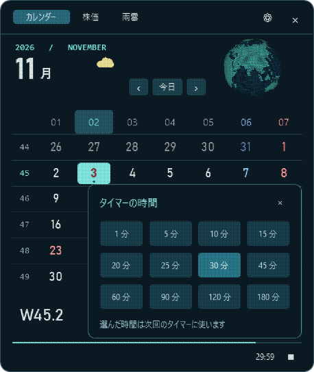

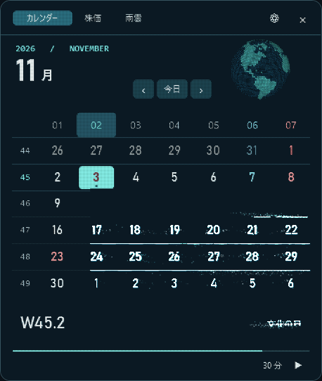

時間表示をクリックすると、カレンダー内に時間選択パネルが開きます。1〜180分の候補から選び、隣の▶で開始します。初期値は30分です。■で停止でき、時間の選択は次のタイマーから適用され、作動中の残り時間表示を置き換えません。

タイマー中は左側に、ウィンドウ幅の約8割の長さのゲージが粒子で現れ、経過時間に応じて伸びます。ゲージはフッター上段、時刻とボタンは下段に置き、長い時間表示とも重ならないようにしています。右側の再生・停止ボタンの位置は、ゲージの表示・非表示によって動きません。ウィンドウを閉じても、粒子で描いた小窓に残り時間を表示します。小窓は時間の桁数に合わせて幅を調整し、数字と右のバーの間の余白を抑えています。左の砂時計は経過時間に合わせて上の砂が減り、下の砂が増え、砂粒が落ちるアニメーションを表示します。小窓右端のゲージも連動します。小窓をクリックすると前のタブに戻り、終了時には音とWindows通知で知らせます。

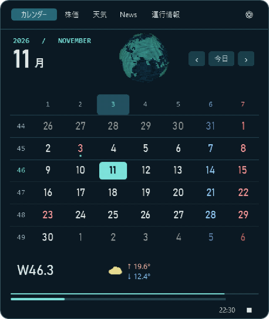

## 起動と終了

`OrbitCalendar.exe` をダウンロードしてダブルクリックします。インストール不要で、Windows 11と.NET Framework 4.8以降を使用します。

タスクバーの時刻か日付をクリックして開きます。日時の位置を検出できない構成では、通知領域の惑星アイコンから開けます。日時または惑星アイコンを右クリックし、「Orbit Calendar を終了」で終了します。標準の通知センターは Win+N から開けます。

天気（雨雲・3日間予報）・News・運行情報の取得中は、青緑の粒子が流れるアニメーションを表示します。ニュースの画像を取得している間も、画像欄で同じアニメーションが動きます。タブ切り替えや画面を閉じたときは終了し、更新失敗や未取得の路線がある場合はその状態を表示します。古い情報や未取得の情報を、現在の平常運転とは扱いません。


## UI確認

[UIレビューの確認内容と修正点](docs/ui-review.md)

カレンダー・粒子設定・時間選択・統合検索・登録管理・日経平均・ドル円・オルカン・雨雲・3日間予報・News・運行情報を確認しています。操作中に内容が動かないホバー枠、濃紺と青緑のツールチップ、無効なボタンの表示、長い文の省略表示と折り返すツールチップを共通化しています。タイマーの実行中に時間を選び直すと、次回のタイマーに適用されることをパネル内で案内します。

## ビルド

Windowsの64ビット環境でリポジトリのルートから実行します。

```powershell
powershell -NoProfile -ExecutionPolicy Bypass -File .\build.ps1
.\build\OrbitCalendar.exe
```

粒子表現は @nomotech さんの作品を参考にしています。[画面の組み替え](https://x.com/nomotech/status/2087916696455795123) · [地球儀](https://x.com/nomotech/status/2087515108713111556) · [株価と雨雲](https://x.com/nomotech/status/2087917639263993951)
