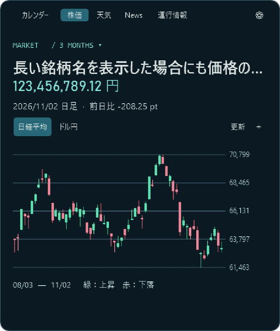

# UIレビュー（2026-11-03）

カレンダー・株価・天気・News・運行情報と、設定・時間選択・コンパクトタイマーを確認しました。検証は公開地点の東京駅と一時設定で行い、保存済みの地点・銘柄・表示設定は変更していません。

| 対象 | 確認した内容 | 結果 |
| --- | --- | --- |
| 全体 | 余白、文字の重なり、パネルの収まり、80%に縮小した表示 | 確認済み |
| カレンダー | 日付・週番号・曜日番号・天気・祝日、設定・時間選択 | 確認済み |
| 株価 | 長い銘柄名、価格・単位、グラフ、期間・銘柄切り替え | 銘柄名と価格を別行にして、価格が隠れないよう修正 |
| 天気 | 雨雲・3日間予報、読み込み、再生、地図とグラフ | 確認済み |
| News | 画像・説明、カテゴリー・記事送り、取得失敗後の表示 | 記事送り・再表示後も更新失敗の案内を保持 |
| 運行情報 | 平常、遅延、未取得、更新失敗 | 状態を区別する表示を確認 |
| タイマー | 実際の開始・停止、次回の時間変更、閉じる・小窓から開く | 作動中の表示と小窓への切り替えを修正 |
| アニメーション | 読み込み、連続したタブ移動、途中キャンセル、ゲージ開始・停止 | 残留するゲージ粒子と小窓のサイズ変更時の描画を修正 |

## 修正した点

- タイマー作動中に次回の時間を選んでも、残り時間を一瞬置き換えないようにしました。時間選択パネルの案内も開始・停止に追従します。
- 閉じるアニメーションの終了後、タイマー小窓をすぐ表示します。小窓から開いた際も残り時間を更新します。
- 開始直後に停止した場合、飛んでいるゲージの粒子を残さないようにしました。
- 小窓の表示幅が変わった際、粒子を描く画像の幅も更新して数字の歪みを防ぎます。
- 株価は銘柄名と価格を別の行に分けました。長い銘柄名は省略されても、価格と単位を確認できます。
- 長いツールチップを折り返して表示します。
- 天気の3日間予報・News・運行情報でも、取得完了後に粒子が内容を組み上げる表示に揃えました。ニュース画像の追加表示も、変更箇所の粒子を動かしてつなぎます。
- Newsの更新に失敗した場合、記事送り・画像読み込み・ウィンドウの再表示で警告が消えないようにしました。

## 動作確認

Windows上の実際のクリック操作で、タイマー開始・時間選択・閉じる・小窓からの再表示・停止を確認しました。各画面はWPFの描画結果でも確認しています。

`tools/verify-review.ps1` は実際のタイマー制御を使って、開始・停止・次回時間・小窓・再表示、粒子のキャンセルとサイズ変更、長い銘柄名、全タブ、縮小表示、短時間でのタブ切り替え、更新失敗の保持を検証します。既存の銘柄管理と天気・News・運行情報の実データ検証も実施しています。
