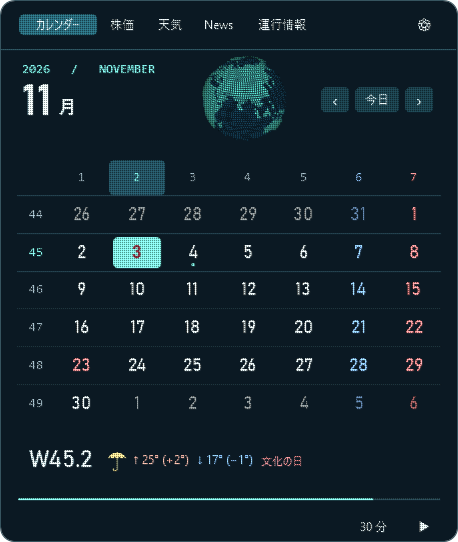
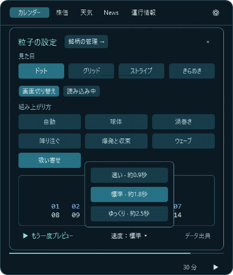
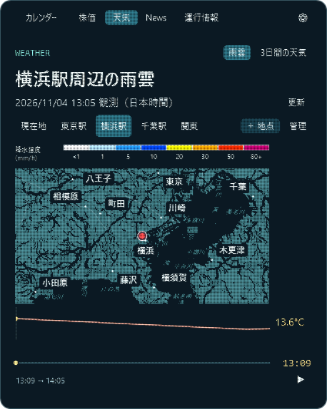
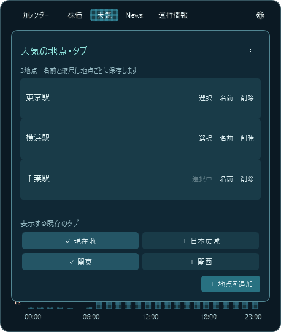
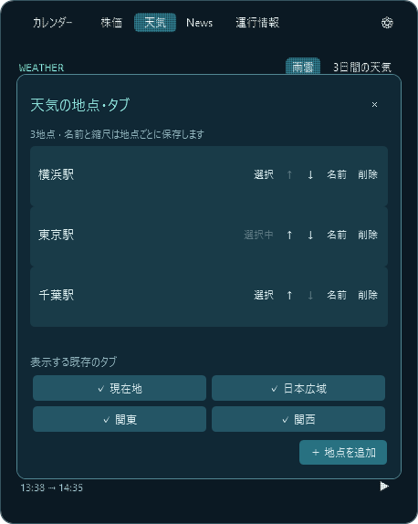
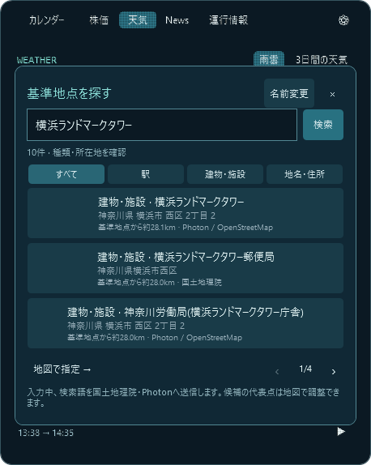
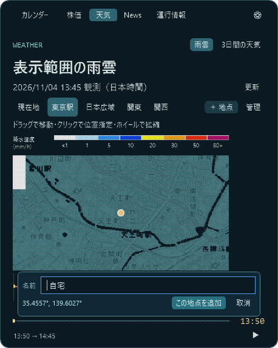

# UI・デザインレビュー（2026-11-04）

濃紺の背景、青緑の選択色、粒子で描く文字とアニメーションに統一感があります。見出し・価格・日付が大きく、操作は上部、補助情報は下部にまとまっています。今回の表示・操作確認では、重大な文字の重なりや画面外へのはみ出しは見つかりませんでした。未取得路線名の案内と演出速度の設定は追加済みです。次に優先したい改善は、小さい注釈の読みやすさです。

## 今回変更した配置

カレンダー下部の左に週・曜日番号と祝日名を置き、間を10px空けました。天気アイコンと最高・最低気温は、まとまりとして右端に揃えています。すべて同じ高さの1行です。祝日名が長い場合は省略し、ツールチップで全文を確認できます。

## 確認した画面

| 対象 | 確認内容・所見 |
| --- | --- |
| カレンダー | 祝日の実クリック、週・曜日番号と祝日名の間隔、右端に固定した天気・気温。負の気温・大きな前日比・長い祝日名でも1行の範囲に収まることを検証しました。 |
| 株価 | 銘柄名と価格が別行になり、主従が明確です。長い銘柄名・大きな価格の表示、期間メニューを開く操作を確認しました。 |
| 天気 | 地図、凡例、気温グラフの配置と、3日間予報への切り替えを実操作で確認しました。カードとグラフの下端は画面内に収まっています。 |
| News | 記事のタイトル・画像・説明・配信時刻の配置、記事クリックによる次の記事への切り替え、画像取得中の粒子表示を確認しました。 |
| 運行情報 | 実データで一部路線の情報が取得できない状態を確認しました。「確認できない路線がある」と表示し、平常運転との区別を保っています。未取得の路線名は画面に表示し、遅延情報と併存する場合や絞り込みにも対応しています。 |
| 設定 | 濃紺と青緑で他の画面と揃っています。画面切り替え／読み込みの選択、6つの読み込みデザイン、ドットキューブのプレビューを実操作で確認しました。 |
| タイマー | 時間選択と5分への変更、開始、残り時間とゲージ、小窓の表示を実操作で確認しました。開始・停止・再表示とボタン位置の維持はアプリの検証でも確認しています。小窓からの実クリックでの復帰については下記の確認制限があります。 |
| アニメーション | 日付・タブ・設定・記事の変更と、取得中／取得後の粒子表示を確認しました。タブを連続して変更した際の読み込み表示の終了は検証スクリプトで確認しています。 |

## 改善候補

| 優先度 | 気になる点 | 提案 |
| --- | --- | --- |
| 中 | 降水強度の凡例やNewsの配信時刻など、9〜10pxの小さい文字は粒子表現で細部を読み取りにくくなります。 | 補助文字を1〜2px大きくするか、小さい文字だけ粒子の密度・明るさを調整するのがよいと思います。 |
| 対応済み | 未取得の路線名を特定しにくい点。 | 路線名の一覧を画面とツールチップに表示し、遅延情報との併存と絞り込みにも対応しました。 |
| 対応済み | 粒子演出の長さを変更できない点。 | 速い／標準／ゆっくりの3段階を設定下部に追加しました。画面の開閉と銘柄設定の入力への切り替えも連動します。 |

未対応の改善候補は小さい文字の可読性です。未取得路線名の案内と粒子演出速度は、上記のとおり実装しました。

## 確認方法と範囲

Windows上で実際にクリックして確認し、WPFの描画結果と画面内の要素の位置でも検証しました。公開地点の東京駅と一時設定を使い、保存済みの地点・銘柄・表示設定は変更していません。

- `tools/verify-calendar-weather.ps1`：前日比の実データ、祝日選択、左の番号と祝日名の間隔、右端への天気の整列、長い文字と負の気温、3日間予報。合格しました。
- `tools/verify-review.ps1`：実際のタイマー制御による開始・停止・再表示、小窓、粒子のキャンセル、長い銘柄名と価格、全タブのレイアウト・読み込み、縮小表示、連続切り替え、更新失敗の案内。合格しました。

小窓をクリックして戻る実操作では、ウィンドウを再取得する際に操作ツールが `window id 593262 was not found`、再試行で `window is not a usable app window` を返したため、復帰画面の最終確認はできませんでした。アプリの検証スクリプトでの復帰は合格しています。この実クリックの安定性は、本体と操作環境のどちらが原因かも含めて未確認です。

## 未取得路線と演出速度の追加確認

`tools/verify-transit-speed.ps1` で旧設定の読み込み、3段階の組み上がりと閉じる時間、保存・再読み込み、速度メニューとプレビュー・出典ボタンの収まり、銘柄設定の入力への切り替え、未取得と遅延が混在する場合の名前、絞り込み、更新失敗、ページ送りの収まりを検証し、合格しました。既存のタイマー・全タブの表示と読み込み、6つの読み込みデザインの検証も合格しています。

## 地点検索の追加確認

駅名・地名・住所の入力欄を既存の濃紺・青緑のデザインに揃えました。1ページ4件とし、検索結果・ページ送り・送信先の案内が重ならないことを確認しています。開閉とページ送りには粒子演出を使い、入力を始めると操作を優先します。検索中の粒子ローディングも表示設定を使います。

`tools/verify-place-search.ps1` で天王町駅・横浜市・丸の内の住所の実検索、完全一致優先、重複と範囲外データの除外、ページ送り、地図の移動、確定前に保存しないこと、保存と再読み込み、天気予報とカレンダーの地点反映、検索の取消とタブ切り替え、地図クリックでの指定を確認し、合格しました。既存の銘柄検索の粒子演出を共通化したため、その入力画面と速度設定・運行情報の検証も再実行し、合格しています。

別の一時設定で開いた実際のWindowsウィンドウでも、駅名を入力して検索し、候補をクリックして地図へ移動する操作と表示を確認しました。アプリ利用中の保存地点は変更していません。

## 保存地点名の確認

検索で選択した名前を座標と同じファイルへ原子的に保存し、雨雲の見出し・3日間予報・カレンダーの天気のツールチップへ反映しました。検索後に地図で微調整しても名前を保持し、新しい地図指定を始めると候補名をリセットします。名前のない旧データは従来どおり読み込みます。長い見出しは既存の省略表示と全文ツールチップを使います。

`tools/verify-place-search.ps1` で旧データの読み込み、選択した地点名と座標の保存、別プロセスでの再読み込み、雨雲と3日間予報とカレンダーの名称、候補の取消、地図指定への切り替え、コンマを含む名前、自動測位へ戻す際の名前消去を確認し、合格しました。検証には一時ファイルを使用し、ユーザー設定を参照する地点名もテスト内でリセットしています。

## 名前の編集と縮尺の記憶

「地点指定」の右上に「名前変更」を追加し、既存の入力画面と同じ濃紺・青緑の編集パネルを用意しました。名前の保存・取消を分け、空欄には入力案内を表示します。開閉は設定された粒子演出を使います。編集時には座標・縮尺・表示範囲・雨雲の再生位置を維持し、保存後はキャッシュ内の見出しやカレンダーの天気にも新しい名前を反映します。

地図の縮尺は4つの表示範囲ごとに保存し、ホイール操作の時点で記録します。ズーム前のキャッシュで戻らないようにし、拡大縮小の直後に閉じた場合も開き直して選択した縮尺を取得します。縮尺の保存先をテスト専用に切り替え、通常の地点・表示設定を変更せず検証しています。

`tools/verify-place-options.ps1` による編集パネルの収まり・入力への切り替え、空欄・取消・Esc・保存失敗時の元データ保持、座標・表示範囲・再生位置の維持、天気各画面の名称、実際のホイール処理による縮尺の保存、拡大縮小直後の閉じる／再表示、タブ・保存地点への復帰、範囲ごとの独立性、不正な設定と書き込み失敗への対処、別プロセスでの名前と縮尺の復元を確認し、合格しました。既存の駅名・住所検索と地点保存の検証も合格しています。

## 複数地点と既存タブの管理

天気の地点切り替えを横スクロールのタブにし、右端に「＋ 地点」「管理」を固定しました。登録地点は雨雲・3日間予報の両方から選べ、地点名と縮尺を個別に保存します。管理パネルは既存の濃紺・青緑と粒子演出を使い、長い名前は省略してツールチップに全文を表示し、地点が多いときはパネル内だけをスクロールします。スクロールバーも青緑に揃えました。

既存の現在地・日本広域・関東・関西は管理パネルのボタンから非表示にでき、同じ場所から復元できます。地点の削除は2段階で確定します。選択中の地点を削除したときは残りの地点に切り替え、最後の地点を削除したときは現在地を表示可能に戻します。旧版の1地点分の名前・座標・縮尺は引き継ぎます。

`tools/verify-multiple-places.ps1` で旧保存データの移行、追加で既存地点を残すこと、地点別の名前・縮尺、別プロセスでの選択地点・非表示設定の復元、保存失敗時の保持、雨雲・3日間予報・カレンダーの連動、長い名前と11地点での横・縦スクロールと操作ボタンの収まり、非選択地点の名前変更、タブの非表示と復元、削除とフォールバック、運行情報への表示漏れがないことを確認し、合格しました。既存の地点検索と名前・縮尺の検証も合格しています。すべて一時設定と公開地点での確認です。

## 登録順・追加前の位置合わせ・検索の改善

管理パネルに上下ボタンを追加し、登録地点の並び順をタブへ即時反映して保存します。選択中の地点や縮尺はそのままです。検索は2文字以上、入力が0.65秒止まってから自動で開始し、日本語の変換中は待機します。変更前の検索・待ち時間は画面を閉じたときに取り消します。

検索結果は1ページ3件とし、種類・市区町村などの所在地・基準地点からの距離・取得元を表示します。駅／建物・施設／地名・住所で絞り込め、Photon/OpenStreetMapの候補を加えて建物・店舗名を補います。市区町村名の対応表は国土地理院の公開データを同梱し、追加の座標問い合わせは行いません。建物名の収録は取得元のデータ範囲に依存します。

登録前の地図ではドラッグによる移動と短いクリックによる位置指定を分け、縮尺レベル18までの詳細地図を使えるようにしました。既存地点の位置や縮尺は変えず、確定した位置と縮尺を新しい地点へ保存します。雨雲画像は配信元の親タイルを位置を合わせて拡大し、予報の元の解像度を維持します。

`tools/verify-place-workflow.ps1` で管理画面の移動ボタンとタブ順、別プロセスでの順序と縮尺の復元、変換中の待機・自動検索・キャンセル、駅フィルターと所在地、実際の横浜ランドマークタワー検索、詳細地図とホイール操作、ドラッグで登録ピンが動かないこと・クリックで位置が変わること、確定前の既存地点の保持、調整した座標と縮尺の登録を確認し、合格しました。従来の駅・住所検索の検証も合格しています。

登録確認欄を名前と座標の2行に収め、地図のクリック領域を覆わないことも確認しました。自動検索の完了後に入力欄からフォーカスを移しても、同じ検索を再実行してページ送りを先頭へ戻さないようにしています。

## 追加前の地点名編集

登録前の確認欄に濃紺・青緑の名前入力欄を追加しました。検索候補名を初期値にし、地図だけで指定する場合は「地点N」を提案します。名前を入力する実際のコントロールは粒子描画の外側に置き、カーソル・日本語入力を通常どおり使えるようにしています。確認欄の出現には既存の粒子演出を使い、編集操作を始めると入力を優先します。

名前入力と登録ボタンを2行に収め、確認欄が地図のクリック領域を覆わないことを確認しました。名前を変更しても地図の移動・拡大縮小・位置の再指定で元に戻らず、保存時に名前・座標・縮尺をまとめて追加します。空欄には入力案内を表示し、保存失敗時は編集内容を残して再試行できます。

`tools/verify-candidate-name.ps1` で検索候補名と地図指定時の初期値、文字入力の表示、ドラッグ・縮尺変更・位置調整時の名前保持、地図と入力欄とボタンの収まり、空欄の拒否、保存失敗時の保持、取消・タブ移動時の破棄、追加前の既存地点の保持、名前入力が検索を開始しないこと、カレンダーと天気への反映、別プロセスでの名前・調整位置・縮尺の復元を検証し、合格しました。一時設定と公開地点を使い、「自宅」はテスト用の仮名です。

